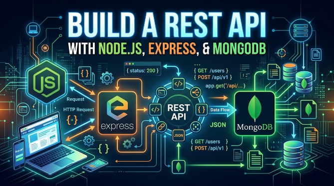
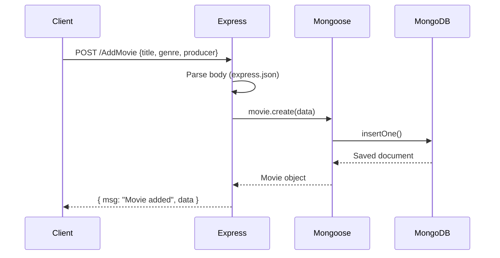
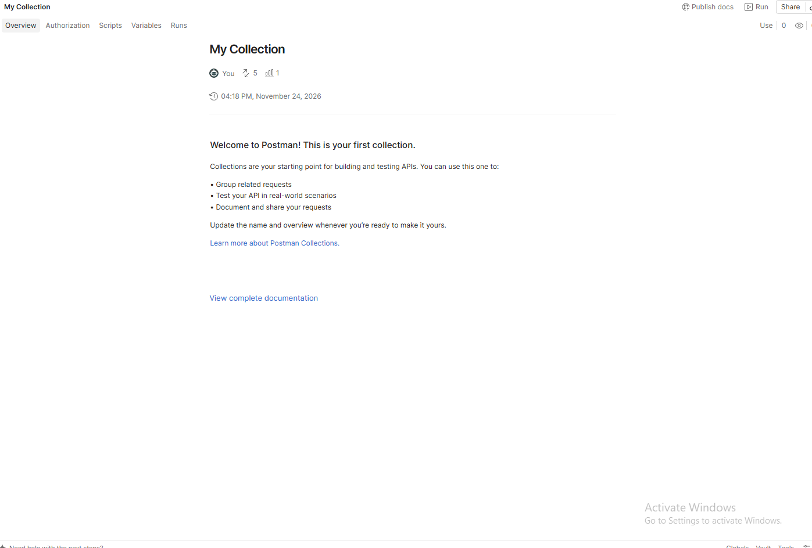
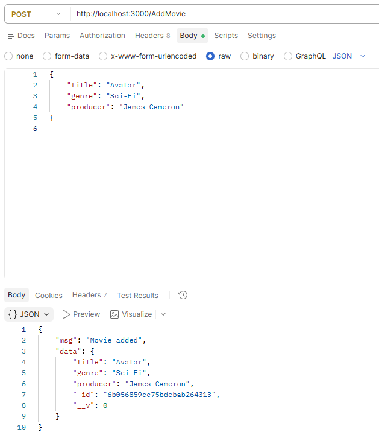
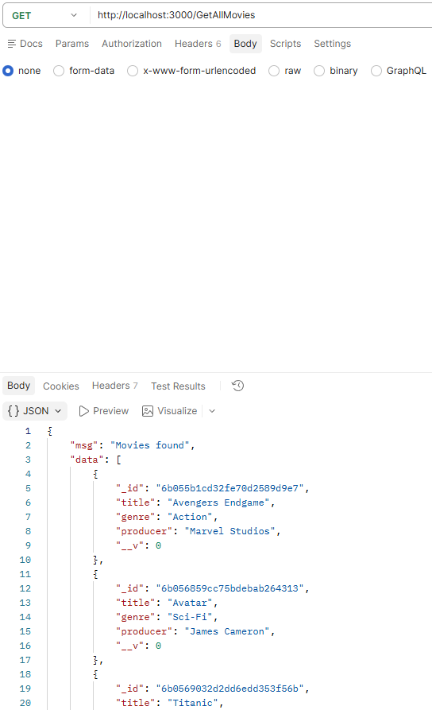
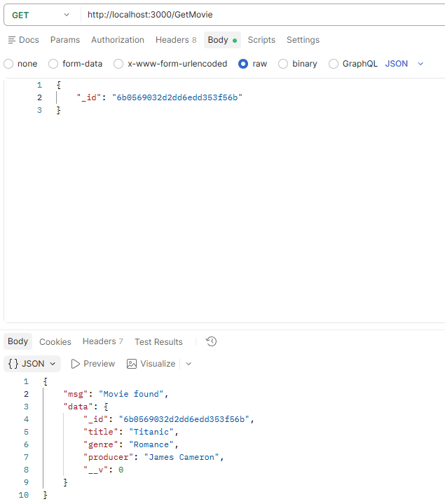
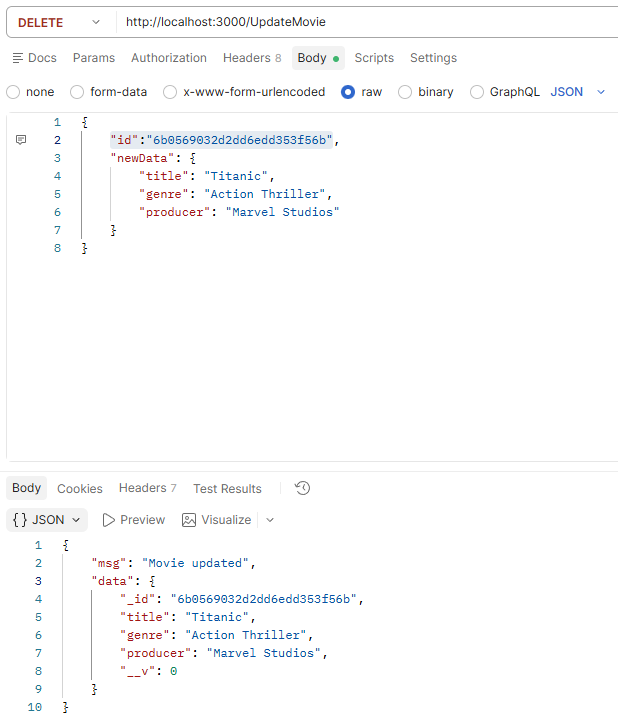
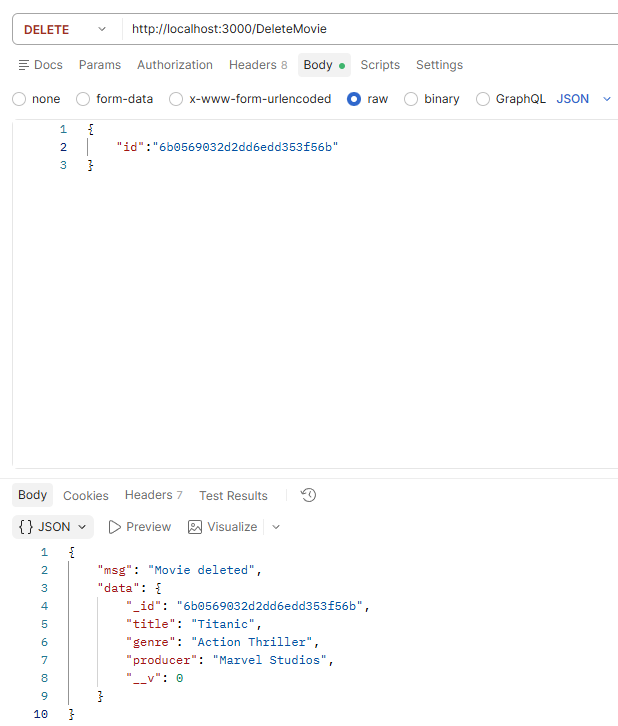

<div align="center">

# 🎬 Movie Management REST API

### A clean, lightweight CRUD backend built with Node.js, Express 5 & MongoDB

<br />


<br />

[Features](#-features) •
[Quick Start](#-quick-start) •
[API Reference](#-api-reference) •
[Screenshots](#-screenshots) •
[Roadmap](#-roadmap)

<br />

<!-- 📸 Replace with a banner / hero screenshot of your project -->


</div>

---

## 📖 About The Project

**Movie Management REST API** is a backend service that lets clients create, read, search, update and delete movie records stored in MongoDB. It is built as a minimal, easy-to-understand foundation that demonstrates core backend concepts: routing, request parsing, schema modeling, async database operations, and JSON API design.

**Why this project?**

- 🧩 Clear example of a full **CRUD** workflow
- ⚡ Fast setup, with only one command to run in development
- 🧱 A solid base to extend with authentication, validation and more

---

## ✨ Features

| | Feature | Description |
|---|---------|-------------|
| ➕ | **Create** | Add new movies with title, genre and producer |
| 📚 | **Read All** | Retrieve the complete movie collection |
| 🔍 | **Search** | Find a movie by any combination of fields |
| ✏️ | **Update** | Modify a movie by its ID and receive the updated document |
| 🗑️ | **Delete** | Remove a movie by its ID |
| 🔄 | **Hot Reload** | Auto-restart on code changes with Nodemon |
| 📦 | **ES Modules** | Modern `import/export` syntax |

---

## 🛠 Tech Stack

<div align="center">

| Layer | Technology |
|-------|------------|
| **Runtime** | Node.js |
| **Framework** | Express 5 |
| **Database** | MongoDB |
| **ODM** | Mongoose 9 |
| **Dev Tool** | Nodemon |
| **API Testing** | Postman / Thunder Client |

</div>

---

## 🏗 Architecture

```mermaid
flowchart LR
    A[👤 Client<br/>Postman / Browser / App] -->|HTTP Request<br/>JSON| B[🚀 Express Server<br/>Port 3000]
    B --> C{Route Handler}
    C -->|Mongoose Model| D[(🍃 MongoDB<br/>myData → movies)]
    D -->|Document(s)| C
    C -->|JSON Response| A
```

### Request Lifecycle



---

## 📁 Project Structure

```
first-pr/
├── 📄 app.js               # Server, DB connection, schema & all routes
├── 📄 package.json         # Scripts & dependencies
├── 📄 package-lock.json    # Locked dependency tree
├── 📂 screenshots/         # README images
└── 📄 README.md            # You are here
```

---

## 🚀 Quick Start

### Prerequisites

| Requirement | Version | Link |
|-------------|---------|------|
| Node.js | v18 or higher | [Download](https://nodejs.org/) |
| MongoDB Community | Running on `27017` | [Download](https://www.mongodb.com/try/download/community) |
| Postman (optional) | Latest | [Download](https://www.postman.com/downloads/) |

### Installation

```bash
# 1. Clone the repository
git clone <your-repository-url>

# 2. Move into the project folder
cd first-pr

# 3. Install dependencies
npm install
```

### Run

```bash
# Development (auto-reload with Nodemon)
npm run dev

# Production / plain run
node app.js
```

✅ Server runs at **`http://localhost:3000`**
✅ Terminal shows **`mongodb connect`** once the database is connected

<details>
<summary><b>📸 Click to view: Server running screenshot</b></summary>
<br />


</details>

---

## ⚙️ Configuration

Current defaults (defined in `app.js`):

| Setting | Value |
|---------|-------|
| Server Port | `3000` |
| MongoDB URI | `mongodb://127.0.0.1:27017/myData` |
| Collection | `movies` |

---

## 🗂 Data Model

```js
{
  title:    String,
  genre:    String,
  producer: String
}
```

| Field | Type | Required | Example |
|-------|------|----------|---------|
| `_id` | ObjectId | Auto | `665f1c2e8b3a2f0012a4d123` |
| `title` | String | – | `"Inception"` |
| `genre` | String | – | `"Sci-Fi"` |
| `producer` | String | – | `"Christopher Nolan"` |
| `__v` | Number | Auto | `0` |

---

## 📡 API Reference

**Base URL:** `http://localhost:3000`
**Content-Type:** `application/json`

### Endpoints Overview

| Method | Endpoint | Description | Body |
|:------:|----------|-------------|------|
|  | `/` | Health check | – |
|  | `/AddMovie` | Create a movie | `title`, `genre`, `producer` |
|  | `/GetAllMovies` | List all movies | – |
|  | `/GetMovie` | Find one movie | Any field(s) |
|  | `/UpdateMovie` | Update a movie | `id`, `newData` |
|  | `/DeleteMovie` | Delete a movie | `id` |

---

<details open>
<summary><h3>🏠 1. Home</h3></summary>

```http
GET /
```

**Response**

```json
{
  "msg": "Home page"
}
```



</details>

---

<details open>
<summary><h3>➕ 2. Add Movie</h3></summary>

```http
POST /AddMovie
```

**Request Body**

```json
{
  "title": "Inception",
  "genre": "Sci-Fi",
  "producer": "Christopher Nolan"
}
```

**Response**

```json
{
  "msg": "Movie added",
  "data": {
    "_id": "665f1c2e8b3a2f0012a4d123",
    "title": "Inception",
    "genre": "Sci-Fi",
    "producer": "Christopher Nolan",
    "__v": 0
  }
}
```

**cURL**

```bash
curl -X POST http://localhost:3000/AddMovie \
  -H "Content-Type: application/json" \
  -d '{"title":"Inception","genre":"Sci-Fi","producer":"Christopher Nolan"}'
```



</details>

---

<details open>
<summary><h3>📚 3. Get All Movies</h3></summary>

```http
GET /GetAllMovies
```

**Response**

```json
{
  "msg": "Movies found",
  "data": [
    {
      "_id": "665f1c2e8b3a2f0012a4d123",
      "title": "Inception",
      "genre": "Sci-Fi",
      "producer": "Christopher Nolan",
      "__v": 0
    }
  ]
}
```

**cURL**

```bash
curl http://localhost:3000/GetAllMovies
```



</details>

---

<details open>
<summary><h3>🔍 4. Get Single Movie</h3></summary>

```http
GET /GetMovie
```

**Request Body** (any field to match)

```json
{
  "title": "Inception"
}
```

**Success Response**

```json
{
  "msg": "Movie found",
  "data": {
    "_id": "665f1c2e8b3a2f0012a4d123",
    "title": "Inception",
    "genre": "Sci-Fi",
    "producer": "Christopher Nolan",
    "__v": 0
  }
}
```

**Not Found Response**

```json
{
  "msg": "Movie is not found"
}
```



</details>

---

<details open>
<summary><h3>✏️ 5. Update Movie</h3></summary>

```http
PUT /UpdateMovie
```

**Request Body**

```json
{
  "id": "665f1c2e8b3a2f0012a4d123",
  "newData": {
    "genre": "Thriller"
  }
}
```

**Success Response** (returns the updated document)

```json
{
  "msg": "Movie updated",
  "data": {
    "_id": "665f1c2e8b3a2f0012a4d123",
    "title": "Inception",
    "genre": "Thriller",
    "producer": "Christopher Nolan",
    "__v": 0
  }
}
```

**Not Found Response**

```json
{
  "msg": "Movie is not found"
}
```



</details>

---

<details open>
<summary><h3>🗑️ 6. Delete Movie</h3></summary>

```http
DELETE /DeleteMovie
```

**Request Body**

```json
{
  "id": "665f1c2e8b3a2f0012a4d123"
}
```

**Success Response** (returns the deleted document)

```json
{
  "msg": "Movie deleted",
  "data": {
    "_id": "665f1c2e8b3a2f0012a4d123",
    "title": "Inception",
    "genre": "Thriller",
    "producer": "Christopher Nolan",
    "__v": 0
  }
}
```

**Not Found Response**

```json
{
  "msg": "Movie is not found"
}
```



</details>

## ⚠️ Known Limitations

Being transparent about the current scope of the project:

| Area | Current Behavior |
|------|------------------|
| **Validation** | No required fields or type validation on the schema |
| **Error handling** | No `try/catch`; an invalid ID format will cause a server error |
| **Status codes** | "Not found" responses are returned with the default `200` status |
| **GET with body** | `/GetMovie` reads from the request body, which some clients and browsers don't support |
| **Config** | DB URL and port are hardcoded in `app.js` |

These are all addressed in the roadmap below.

---

## 🗺 Roadmap

- [x] Basic CRUD operations
- [x] MongoDB integration with Mongoose
- [x] Development workflow with Nodemon
- [ ] Input validation (Joi / express-validator)
- [ ] Proper HTTP status codes (`201`, `400`, `404`, `500`)
- [ ] Centralized error handling middleware
- [ ] Query params for search (`/GetMovie?title=Inception`)
- [ ] Environment variables with `dotenv`
- [ ] Modular structure (routes / controllers / models)
- [ ] Pagination, sorting and filtering
- [ ] JWT authentication
- [ ] API documentation with Swagger
- [ ] Unit & integration tests
- [ ] Docker support

---

## 🤝 Contributing

Contributions are welcome!

1. Fork the project
2. Create your feature branch: `git checkout -b feature/AmazingFeature`
3. Commit your changes: `git commit -m "Add some AmazingFeature"`
4. Push to the branch: `git push origin feature/AmazingFeature`
5. Open a Pull Request

---

## ❓ FAQ

<details>
<summary><b>MongoDB connection fails. What should I do?</b></summary>
<br />

Make sure the MongoDB service is running locally on port `27017`. You can start it with `mongod` or from Services (Windows) / `brew services start mongodb-community` (macOS).

</details>

<details>
<summary><b>Port 3000 is already in use.</b></summary>
<br />

Stop the other process using port 3000, or change the port number in `app.listen(3000)` inside `app.js`.

</details>

<details>
<summary><b>GET /GetMovie doesn't work in my browser.</b></summary>
<br />

This route expects a JSON body, which browsers can't send with a GET request. Use Postman or Thunder Client, or send it via cURL.

</details>

---

## 👨‍💻 Author

<div align="center">

**SHABBIR HATHIYARI**

[](https://github.com/your-username)
[](https://linkedin.com/in/your-profile)
[](mailto:your-email@example.com)

</div>

---

## 📄 License

For Study 

---

<div align="center">

### ⭐ If you found this project helpful, please give it a star!

Made with ❤️ and Node.js

</div>